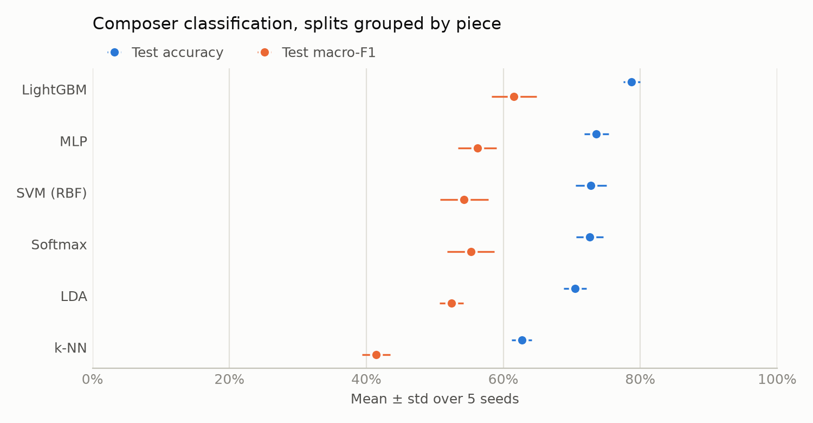
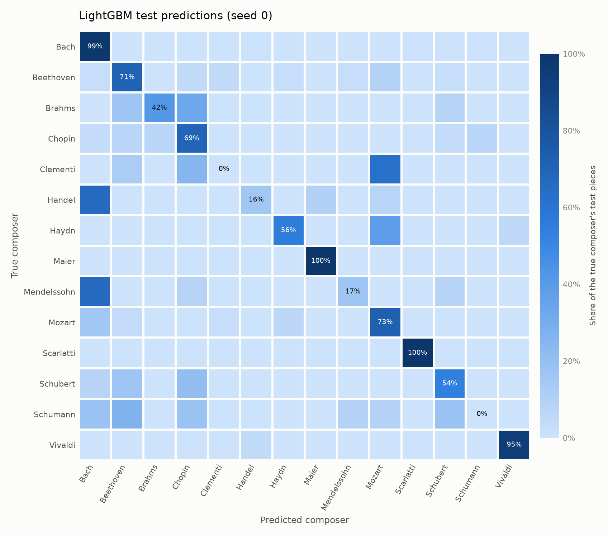
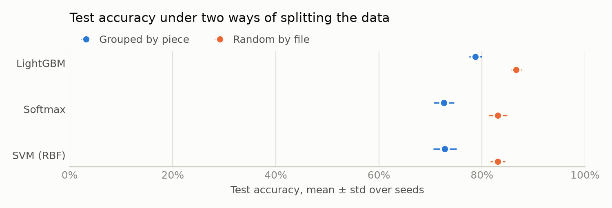
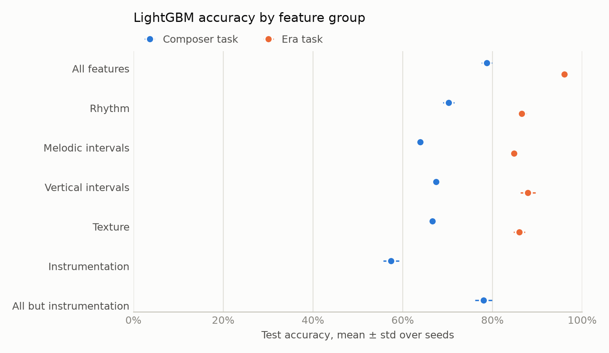
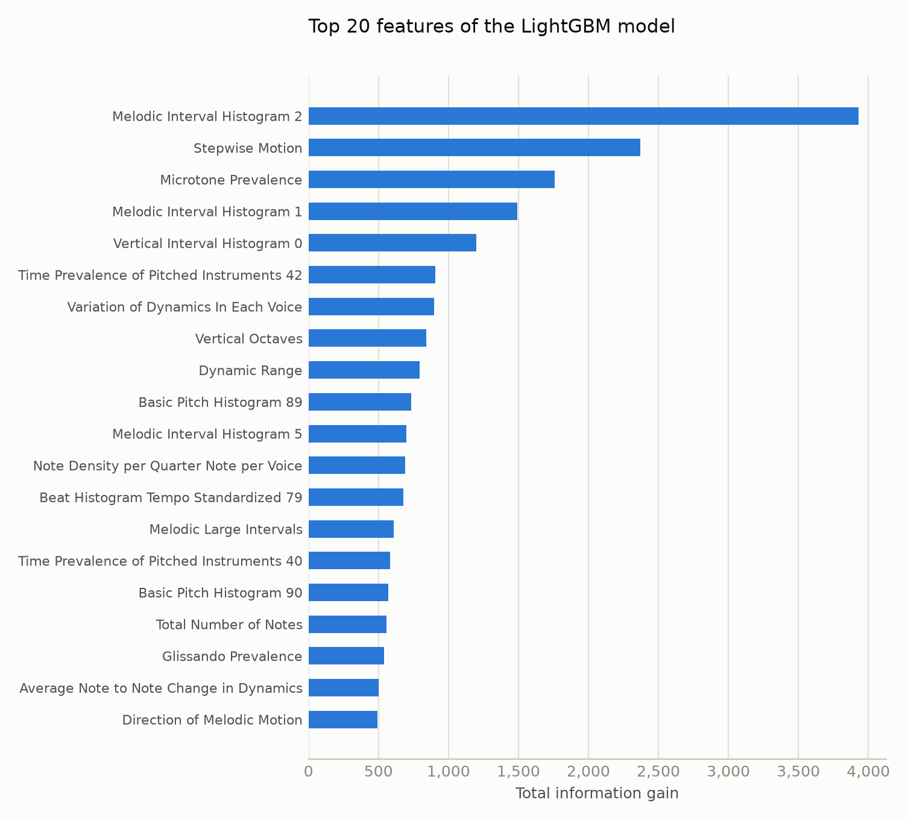
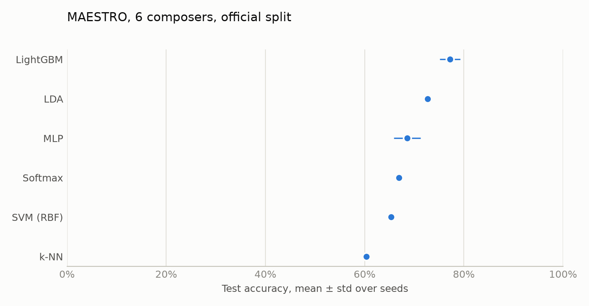
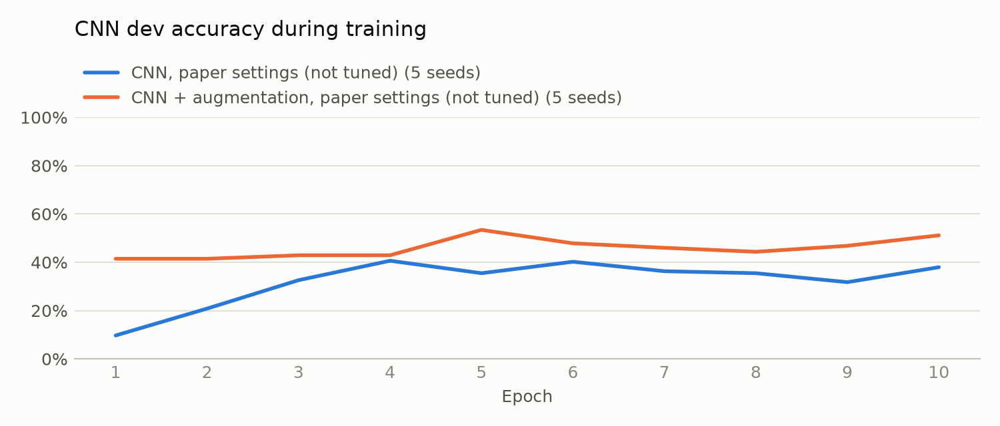

# Composer Classification from Symbolic Music

UE24CS352A Machine Learning mini-project, PES University, Section C, Team 10. The two-page write-up is [docs/writeup.pdf](docs/writeup.pdf).

- Vivian Sobers E (PES1UG24CS901)
- C Nitish (PES1UG25CS809)

## Problem

Problem statement #67: classify pieces of Western classical music by composer from their MIDI encoding alone, and find which musical properties separate composers best. The project reimplements and re-evaluates [Jain, Smit and Yngesjö, "Analysis and Classification of Symbolic Western Classical Music by Composer" (Stanford CS229, 2019)](https://cs229.stanford.edu/proj2019aut/data/assignment_308832_raw/26583519.pdf). The original dataset was never released, so this project uses public data.

## Data

- [midi-classical-music](https://huggingface.co/datasets/drengskapur/midi-classical-music): 4,796 MIDI files with piano, chamber and orchestral works. Used for the feature-based classifiers.
- [MAESTRO v3.0.0](https://magenta.tensorflow.org/datasets/maestro): 1,276 piano performances with a split that keeps each composition in one subset. Used for the piano-roll CNN and a like-for-like comparison against the feature-based models.

Only composers with at least 50 pieces are kept.

## Method

- Features: [jSymbolic 2.2](https://sourceforge.net/projects/jmir/files/jSymbolic/) extracts 1,495 values per piece (pitch, melodic and vertical intervals, rhythm, texture, instrumentation, dynamics). music21's feature extractors are the fallback.
- Classifiers: LightGBM, softmax regression, SVM, LDA, k-NN and an MLP, each given the same tuning budget.
- Evaluation: train/dev/test splits grouped by musical work so that movements or copies of one piece never appear on both sides.
- CNN: a piano-roll image classifier with the original paper's architecture and training settings. We did not tune it, so its results are not tuning-matched with the feature-based models.

## Setup

You need Python 3.13 and a Java runtime for jSymbolic. We tested with OpenJDK 25 on our laptop and OpenJDK 11 on the GPU server.

```bash
python3.13 -m venv .venv
.venv/bin/pip install -e ".[dev,app]"      # add ,cnn for the piano-roll CNN
```

The CPU build of PyTorch is enough for the tests. For training the CNN on a GPU, install the default CUDA build instead (`pip install -e ".[cnn]"`).

Download the two datasets and jSymbolic (about 200 MB in total). The Hugging Face files come down four at a time because the server rate-limits faster downloads, so this step takes around 15 minutes:

```bash
.venv/bin/python -m composer_clf.data.download all
```

Then build the catalogs. This removes duplicate files, gives every file a piece ID (all movements and copies of one work share it) and keeps composers with at least 50 files and 5 distinct pieces:

```bash
.venv/bin/python -m composer_clf.data.catalog
```

Run the tests with `.venv/bin/pytest`. The tests that start jSymbolic are marked slow and skipped by default; run them with `.venv/bin/pytest -m slow`.

## Running the experiments

Extract jSymbolic features for both datasets. Each run splits the files into shards and runs several Java processes at once. If one file runs out of Java heap, jSymbolic drops the whole shard, so those files are retried one at a time with a bigger heap. On our 16-core laptop with 14 GB of RAM we could only afford four 1 GB workers, and the Hugging Face set took a little over two hours. The MAESTRO performances are longer and needed 4 GB heaps, so we ran them on a 26-core server. If a run is interrupted, `--resume` reuses everything already extracted. Files that jSymbolic can't read even then are listed in `data/processed/<dataset>_jsymbolic_failed.txt` (8 of the 2,997 Hugging Face files, none of the MAESTRO files).

```bash
.venv/bin/python -m composer_clf.features.extract --dataset hf
.venv/bin/python -m composer_clf.features.extract --dataset maestro --workers 8 --xmx 4g --retry-xmx 8g --retry-workers 8
```

Every experiment writes one folder per model and seed under `results/<experiment>/`, holding the full config (including the git commit and library versions), the metrics, the dev-set tuning table and the test predictions. Each of the six feature-based models gets eight hyperparameter settings, the best one on the dev set is kept, and the test set is scored once. The CNN keeps the paper's settings and only uses the dev set to pick the epoch. Seeds 0 to 4 are used unless you pass `--seeds`.

```bash
# E1: six classifiers, splits grouped by piece
.venv/bin/python -m composer_clf.run_tabular --exp e1_composers --split grouped

# E2: the same models with a random file-level split, to measure leakage
.venv/bin/python -m composer_clf.run_tabular --exp e2_random_split --split random --models lightgbm softmax svm

# E3: LightGBM on one feature group at a time, for composers and for eras
for g in rhythm melodic vertical texture instrumentation no_instrumentation; do
  .venv/bin/python -m composer_clf.run_tabular --exp e3_composer_$g --features $g --models lightgbm
done
for g in all rhythm melodic vertical texture; do
  .venv/bin/python -m composer_clf.run_tabular --exp e3_era_$g --task era --features $g --models lightgbm
done

# E4: the six classifiers on MAESTRO's official split
.venv/bin/python -m composer_clf.run_tabular --exp e4_maestro_tabular --dataset maestro --split official

# E5: the piano-roll CNN on MAESTRO
.venv/bin/python -m composer_clf.cnn.run --exp e5_cnn_noaug --repeats 1 --device cpu --threads 12
.venv/bin/python -m composer_clf.cnn.run --exp e5_cnn_aug10 --augment --repeats 10 --device cpu --threads 12
```

Both GPU servers were busy with other people's jobs during our runs, so we trained the CNN on CPU with 12 threads. Each seed of the augmented run took about 40 minutes. On a free GPU, pass `--device cuda` instead. The device and thread count are saved in each run's config.

`python -m composer_clf.report` collects every `summary.csv` into `results/tables.md` and redraws the charts in `results/figures/`. Run `train_final` (see Demo) first, because the feature importance chart reads the saved model.

## Results

Every number below is the mean and standard deviation over seeds 0 to 4. [results/tables.md](results/tables.md) has the full table, and the charts are in [results/figures/](results/figures/).

### Composer classification (E1)

On the 14 Hugging Face composers, with splits grouped by piece:

| Model | Test accuracy | Test macro-F1 |
|---|---|---|
| LightGBM | 0.787 ± 0.012 | 0.615 ± 0.033 |
| MLP | 0.736 ± 0.018 | 0.562 ± 0.028 |
| SVM (RBF) | 0.728 ± 0.023 | 0.543 ± 0.035 |
| Softmax | 0.726 ± 0.020 | 0.553 ± 0.034 |
| LDA | 0.705 ± 0.017 | 0.524 ± 0.017 |
| k-NN | 0.627 ± 0.015 | 0.414 ± 0.021 |



Macro-F1 sits well below accuracy because the classes are unbalanced and the small ones are hard. In the seed-0 confusion matrix, Bach, Maier, Scarlatti and Vivaldi are recognised 95% of the time or more, while none of the 8 Clementi or 11 Schumann test pieces is classified correctly, and two thirds of the Handel and Mendelssohn pieces are labelled Bach.



### Leakage from random splits (E2)

Splitting files at random, as the original paper did, makes every model look better than it is. LightGBM goes from 0.787 to 0.867, softmax from 0.726 to 0.831 and the SVM from 0.728 to 0.830. The extra 8 to 10 points come from movements and copies of the same work landing in both train and test.



### Feature groups and eras (E3)

LightGBM trained on one jSymbolic group at a time reaches 0.702 with rhythm features, 0.675 with vertical intervals, 0.666 with texture, 0.639 with melodic intervals and 0.574 with instrumentation. Dropping instrumentation altogether gives 0.780, almost the same as the 0.787 with every feature, so the model is not leaning on which instruments a file uses.

Classifying the era (Baroque, Classical or Romantic) is much easier: 0.960 with all features and between 0.848 and 0.879 with any single group.



Among the most useful features of the final model are Microtone Prevalence and Glissando Prevalence. Classical scores contain almost no microtones or glissandi, so we suspect these pick up pitch-bend messages left by whoever sequenced a file, which would tie them to the source of the file more than to the composer.



### MAESTRO: features against the piano-roll CNN (E4, E5)

On MAESTRO's official split (6 composers), LightGBM again does best at 0.772 ± 0.021. LDA reaches 0.727, the MLP 0.686, softmax 0.669, the SVM 0.653 and k-NN 0.603. The official split is fixed and those four models train deterministically, so their spread over seeds is zero.

The CNN is a negative result. It reaches 0.545 ± 0.045 without augmentation and 0.559 ± 0.025 with ten augmented copies of each training roll, below every feature-based model. Training accuracy is 0.91 without augmentation and 0.99 with it, so the network memorises the 650 training performances. Keep in mind that the CNN used the paper's settings with no tuning and ran on CPU, so this comparison is not tuning-matched and a tuned CNN could do better.





## Demo

The demo is a Streamlit app. You upload a MIDI file, and it shows the predicted composer, the probability of each composer, the features that pushed the prediction most and the piano roll. It uses the LightGBM model selected in E1 for seed 0:

```bash
.venv/bin/python -m composer_clf.train_final
.venv/bin/streamlit run app/streamlit_app.py
```

## Differences from the original paper

- Data. The paper used about 10,000 MIDI files donated by Classical Archives, which were never released. We use the two public datasets above, so our composer set and our numbers are not directly comparable with theirs.
- Splits. The paper split files at random after removing duplicate titles, so different movements or versions of one work could land in both train and test. We group every split by piece, and E2 measures what a random split would have reported instead.
- Scaling. The paper's code fitted a separate `StandardScaler` on the dev set. Ours fits the scaler on the training set only, inside each model's pipeline.
- Tuning. The paper tuned LightGBM by hand and the SVM by grid search. Each feature-based model here gets the same budget of eight configurations, chosen on dev macro-F1. The CNN was not tuned, because the GPUs were taken while we ran it, so treat the CNN against LightGBM comparison as a lower bound for the CNN.
- CNN evaluation. The paper's code set `model.training = False` before scoring, which leaves BatchNorm in training mode, and its released code never scores the test set. We call `model.eval()`, choose the epoch on the dev set and score the test set once.
- MLP. The paper used PyTorch; we use scikit-learn's `MLPClassifier` with the same architecture and optimizer settings.
